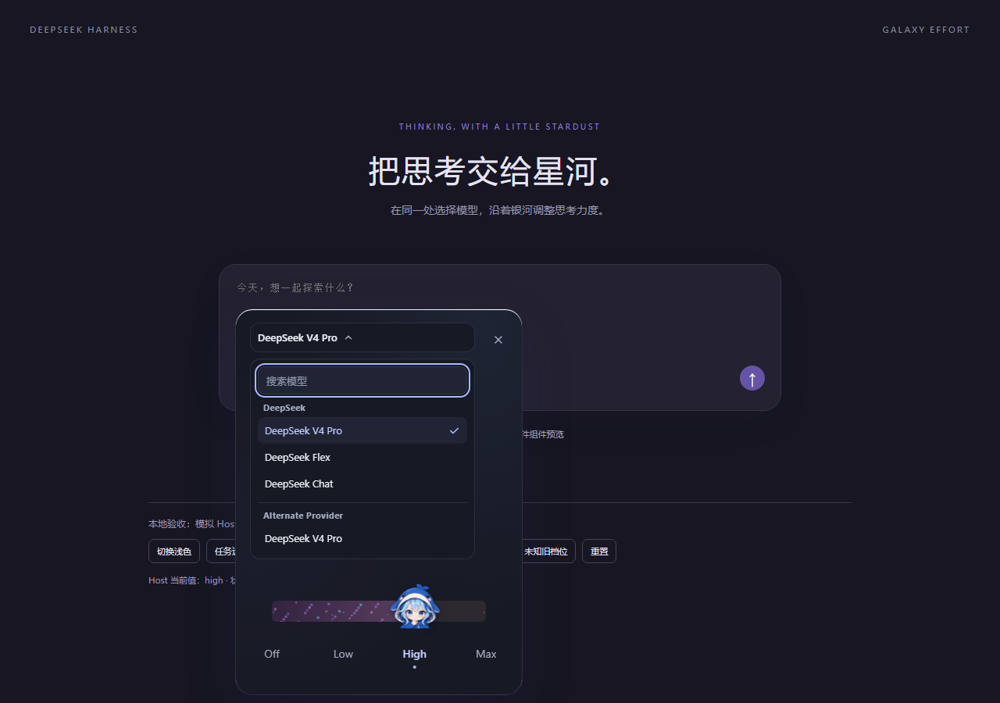

# Galaxy Effort Slider for DeepSeek Harness

English · [简体中文](README.zh-CN.md)

A model-and-effort picker with a flowing pixel nebula and an original chibi whale-girl thumb. While enabled, it occupies the host's combined model-and-effort selector and uses the shared native model directory and selection path used by `/model`.



*Simulated-host view of the v0.1.5 selector replacement; it does not verify rendering in an installed DeepSeek Harness client.*

## Highlights

- **A living pixel galaxy.** Seamless star flow, independently twinkling pixels, and progressively richer layers as the selected effort increases. An advertised `off` or `none` level keeps the rail clear. One star in four carries the twinkle.
- **A responsive character.** The original three-expression whale girl follows the pointer, leans into the drag, and settles onto the chosen level with a damped spring.
- **Real model capabilities.** Levels and labels come directly from the selected provider/model's `reasoning.efforts`. No invented levels or `max`/`xhigh` remapping. Every advertised level stays on the rail; five or more stagger across two rows rather than reflowing away from the positions they describe.
- **Host-authoritative state.** Search models grouped by provider in the shared native directory. The picker reads the active session's model and effort; failed selections keep the host's actual value visible and expose a retryable error.
- **Careful interaction.** Commit on release, cancel interrupted gestures, support keyboard controls, and pause animation when hidden. Reduced-motion and light/dark themes are supported.
- **Small native integration.** Reuses the host's React and services; no production npm dependencies, install-time lifecycle scripts, or additional external servers.

This is an independent third-party plugin, with no affiliation with or endorsement by DeepSeek. The character is an original project asset. The documentation is bilingual; built-in UI helper text is currently Chinese, while effort names come from the host.

## Compatibility

The plugin declares compatibility with **DeepSeek Harness 0.2.0-rc.2** and later 0.2-line releases. The published v0.1.4 integration was checked against official tag `dsh-v0.2.0-rc.2`, commit `639ed015397290b3745d163aafe02ffee4aa3f84` (September 29, 2026). The v0.1.5 build keeps the same compatibility range.

Both `engines.dsh` and the optional `@deepseek-ai/dsh` peer dependency declare `^0.2.0-rc.2`. That range admits the audited rc.2 baseline and later 0.2-line prereleases and releases, while excluding 0.3.0 and anything newer, whose surfaces this plugin has not audited. Making the peer optional prevents package managers from automatically installing another DSH copy; it does not bypass the host's compatibility check.

The published v0.1.4 bundle passed its local, simulated-loader, and browser-preview checks and was installed and enabled in a real Desktop profile running `0.2.1-rc.2`; it registered an extra `conversation.input.left` entry. The v0.1.5 build replaces the combined native selector through `conversation.input.model`. Static inspection of the same Desktop version's ASAR confirmed the single slot, priority ordering, and restoration path when the plugin is disabled. The v0.1.5 replacement passed simulated-host Chromium QA, but has not been visually verified in a running DSH app. Its source-level compatibility evidence covers only `0.2.1-rc.2`; the declared range does not mean every 0.2 release was checked. Other distributions and third-party builds are unverified. See [compatibility details and upstream evidence](docs/COMPATIBILITY.md).

### How selection affects defaults

The slider calls native `ModelDirectory.select` with the full provider/model/effort selection. In the audited Host source, the host applies it to subsequent requests in the current session and asynchronously attempts to save it as the default for new sessions. A successful selection does **not** prove that the default was saved: the native API may still report session-level success if background persistence fails. Neither a live provider selection nor default persistence was exercised in the v0.1.5 simulated-host QA.

## Installation

Back up the target profile's `package.json`, lockfile, and `cordis.patch.yml`. Check `dsh --version`, and use the CLI supplied with your existing **0.2** installation. The commands below target package version **0.1.5**; install from npm only after `npm view` confirms that exact version is available.

### Option A: install a prebuilt package

Use `dsh-galaxy-effort-slider-0.1.5.tgz` if it is attached to the release, or [build the tarball from source](#development). Place it on the machine running the DSH host. For a remote Web installation, that means the server, not your browser's computer.

In the rc.2 interface:

1. Open **Plugins** in the sidebar, then **Add plugin**.
2. Enter the tarball's absolute path in the package field, review the trust notice, and select **Install**.
3. Select **Enable now** after installation. Closing the dialog without this step leaves the plugin installed but disabled.
4. Fully restart the relevant profile if requested, then refresh the page if needed.

This flow follows the [official rc.2 Plugins documentation](https://github.com/deepseek-ai/deepseek-harness/blob/639ed015397290b3745d163aafe02ffee4aa3f84/packages/client/ui-plugin-manager/README.md). If your interface differs, check the client version before proceeding.

For a Web profile, the CLI alternative is:

```sh
dsh --version
dsh plugin --profile web add "/absolute/path/dsh-galaxy-effort-slider-0.1.5.tgz"
```

The CLI adds a newly installed bundle to the chosen profile. If it is disabled, enable it in **Plugins**. Without hot reload, fully restart that profile and refresh the page. The bundle already includes its registration patch; no manual UI patching is needed.

The previously documented GitHub pin `8257d0ab5a645bcd39e64c48312953b6a90befa8` is the v0.1.4 additive build and registers `conversation.input.left`. It does not contain the v0.1.5 selector replacement; do not use that historical commit for this version.

### Option B: install from npm

Check registry availability, then install the versioned package through DSH:

```sh
npm view dsh-galaxy-effort-slider@0.1.5 version
dsh plugin --profile web add dsh-galaxy-effort-slider@0.1.5
```

In the graphical flow, enter `dsh-galaxy-effort-slider@0.1.5` instead of the tarball path, then **Install** and **Enable now**. A plain `npm install` in an unrelated folder does not register a DSH profile plugin.

### Desktop profile

Prefer the **Plugins** interface. Official rc.2 Desktop for macOS/Windows provides **Manage dsh command** to set up its matching CLI ([release notes](https://github.com/deepseek-ai/deepseek-harness/releases/tag/dsh-v0.2.0-rc.2)).

For CLI installation, open Desktop once to initialize its profile, confirm `dsh --version` reports a 0.2-line version (the verified baseline is `0.2.0-rc.2`; `0.2.1-rc.2` was used for the real-install check), and fully quit Desktop before running:

```sh
dsh plugin --profile desktop add "/absolute/path/dsh-galaxy-effort-slider-0.1.5.tgz"
```

Restart Desktop afterward. The npm package specifier `dsh-galaxy-effort-slider@0.1.5` can replace the tarball path. Do not substitute a different CLI with `npx ...@latest` or bypass a compatibility warning.

### Remove

Disable the plugin in **Plugins**, restarting if hot unloading is unavailable. To remove the package, stop the relevant running instance and run:

```sh
dsh plugin --profile web remove dsh-galaxy-effort-slider
```

For Desktop, replace `web` with `desktop` and fully quit the app first. Disabling the plugin restores the native model selector. Removing it does not roll back model or reasoning defaults you previously selected; use the restored selector to change them.

## Usage

While enabled, the plugin replaces the host's combined model-and-effort selector. Open it to search models grouped by provider, choose a model, and set effort with the galaxy slider.

- **Keyboard:** arrow keys, Home/End, Enter/Space, and Escape are supported.
- **Busy or unavailable sessions:** switching is disabled while running, awaiting submission, disconnected/not ready, or while another selection is pending. State is checked again before submission; the host remains responsible for atomic request-boundary and concurrency rules.
- **No reasoning capability:** the plugin does not create choices the model has not advertised. Subagent sessions do not display the control.
- **Unspecified default:** for a model with no declared `defaultEffort`, choose “跟随默认” (follow default) to clear the explicit effort without selecting the first option.
- **Unknown saved effort:** it stays visibly unknown rather than being replaced with the first option.
- **Directory errors:** retry loading directly from the picker.

## Development

Requires **Node.js 20+**. Install this project's development dependencies; there is no need to install or run the full upstream repository.

```sh
npm ci --ignore-scripts
npm run check
npm run preview
```

The preview runs at `http://localhost:4397`. It renders the real adapter and UI against a clearly simulated host, makes no model requests, and consumes no model credits. Controls cover busy sessions, selection failures, unsupported capabilities, unknown saved efforts, and light/dark themes.

Build and package:

```sh
npm run build
npm run test:bundle
npm pack --ignore-scripts
```

`npm run check` runs TypeScript checks, unit/UI/motion tests, the production build, and simulated native-loader checks. These checks do not replace installation testing in a real client.

The browser artifact is a lazy CommonJS factory registered through `window.__ModuleLoader__`, not a standalone ESM script. React, React DOM, and the JSX runtime stay external to reuse the host's copies. The character image is embedded as a data URL; styles are added and removed through the Cordis lifecycle.

To compare a downloaded official rc.2 source tree against the 20 audited file hashes, without importing or running upstream code:

```sh
npm run check:upstream -- /path/to/deepseek-harness-rc2-source
```

Use the exact official tag, not a moving `master` checkout. The evidence manifest is [docs/UPSTREAM-RC2.json](docs/UPSTREAM-RC2.json).

## Project layout

- `src/client.ts`: Cordis dependencies and `conversation.input.model` slot registration
- `src/adapter/`: native model/session bridge, validation, and error handling
- `src/ui/`: galaxy slider, styling, and motion
- `src/assets/`: original character artwork
- `src/ui-contract.ts`: replaceable UI props contract
- `scripts/` and `tests/`: builds, preview tooling, and regression checks
- `preview/`: standalone simulated-host preview
- `docs/`: upstream evidence, compatibility notes, and release notes

## Troubleshooting

**No picker appears.** Confirm the plugin is enabled and that the profile includes the official `ui-conversation`, `ui-model-selection`, and `ui-session` services. Restart the profile. If it still does not appear, collect the host's plugin diagnostics and check the version.

**The host reports incompatibility.** Stop and check [COMPATIBILITY.md](docs/COMPATIBILITY.md). Do not change the version range to `*` or approve a compatibility override just to force installation.

**Different models show different levels.** This reflects the selected provider/model's real directory. Different API routes can expose different capabilities even for the same model name.

## License

[MIT](LICENSE). The retained upstream notice is in [docs/UPSTREAM-LICENSE.txt](docs/UPSTREAM-LICENSE.txt).

See [CHANGELOG.md](CHANGELOG.md) and the [v0.1.4 release notes](docs/RELEASE-NOTES-v0.1.4.md).
