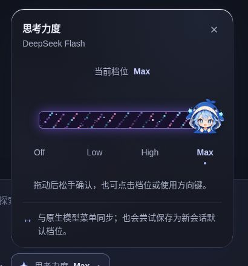

# 银河推理滑块 · DeepSeek Harness 原生插件

[English](README.md) · 简体中文

把流动的像素星云和原创 Q 版鲸鱼女孩放进输入栏。推理档位直接读取当前模型的真实能力，与原生模型菜单、`/model` 共用目录、选择状态和提交入口。



*截图来自使用模拟宿主的独立预览页，并非已安装插件的 DeepSeek Harness 客户端。*

## 功能亮点

- **会流动的像素银河。** 无缝星流、错落闪烁的像素星点，随档位逐渐丰富的星云层次。模型实际提供的 `off` 或 `none` 档位保持轨道清爽。
- **有手感的角色滑块。** 原创三表情鲸鱼女孩跟手移动、随拖动轻轻倾斜，松手后以阻尼弹簧动画归位。
- **只用真实档位。** 档位 ID、名称和顺序取自当前 provider/model 的 `reasoning.efforts`，不虚构能力，也不把 `max` 和 `xhigh` 互相映射。
- **与原生状态同步。** 原生菜单修改会同步显示；提交失败保留宿主真实值，显示错误并允许重试。
- **完整的交互保护。** 拖动只在松手时提交，中断手势会取消；支持键盘操作、减少动态效果和深浅色主题，隐藏时暂停动画。
- **轻量原生集成。** 复用宿主的 React 与服务，没有生产 npm 依赖、安装时生命周期脚本，也不连接额外外部服务器。

这是独立第三方插件，与 DeepSeek 官方没有隶属或背书关系。角色为本项目原创形象。文档提供中英文版本；内置界面提示目前为中文，档位名称由宿主提供。

## 兼容版本

插件 **0.1.4** 以 **DeepSeek Harness 0.2.0-rc.2** 及后续 0.2 线版本为目标。已逐项核对官方标签 `dsh-v0.2.0-rc.2`、固定提交 `639ed015397290b3745d163aafe02ffee4aa3f84`（2026 年 9 月 29 日）的接口。

`engines.dsh` 与可选的 `@deepseek-ai/dsh` peer dependency 均声明 `^0.2.0-rc.2`。该范围接受已核对的 rc.2 基线与后续 0.2 线预发布/正式版本，排除 0.3.0 及更新版本——这些版本的接口尚未核对。将 peer 标为 optional，是为了避免包管理器自动安装另一套 DSH，不会绕过宿主检查。

本地测试、模拟原生加载器和浏览器预览验收已通过。**尚未在真实 DSH profile 或 Desktop 分发包中验证安装。** 其他版本和第三方改版也未认证。详见[兼容说明与上游证据](docs/COMPATIBILITY.md)。

### 选择档位会怎样影响默认值

滑块通过原生 `ModelDirectory.select` 提交完整的 provider/model/effort 选择。宿主将其用于当前会话的后续请求，并异步尝试保存为新会话默认值。切换成功**不代表默认值一定已保存**：后台持久化失败时，原生接口仍可能返回当前会话切换成功。

## 安装

请先备份目标 profile 的 `package.json`、锁文件和 `cordis.patch.yml`，检查 `dsh --version`，并使用现有 **0.2** 安装配套的 CLI。

### 方式一：安装预构建包

发布附件可用时，获取 `dsh-galaxy-effort-slider-0.1.4.tgz`；也可以[从源码构建安装包](#开发与验收)。把文件放到运行 DSH Host 的电脑上。远程 Web 安装使用的是服务器上的路径，而不是浏览器所在电脑的路径。

在 rc.2 界面中：

1. 从侧栏进入 **Plugins（插件）**，点击 **Add plugin**。
2. 在 package 输入框填写 `.tgz` 文件的真实绝对路径，阅读信任提示，然后点击 **Install**。
3. 安装完成后点击 **Enable now**。直接关闭对话框会留下“已安装但未启用”的插件。
4. 若提示需要重启，请完整重启对应 profile；需要时再刷新页面。

以上流程依据固定版本的[官方 Plugins 页面说明](https://github.com/deepseek-ai/deepseek-harness/blob/639ed015397290b3745d163aafe02ffee4aa3f84/packages/client/ui-plugin-manager/README.md)。如果界面不同，请先核对客户端版本。

Web profile 也可以使用 CLI：

```sh
dsh --version
dsh plugin --profile web add "/绝对路径/dsh-galaxy-effort-slider-0.1.4.tgz"
```

CLI 会把首次成功添加的新 bundle 纳入对应 profile；若已被关闭，请在 **Plugins** 页启用。不支持热更新时，完整重启该 profile 并刷新页面。安装包已带有注册 patch，无需手工修改原生 UI。

### 现在即可通过 npm 从 GitHub 下载

下载这个公开仓库不需要 npm 注册账号。电脑上已有 Git 和 npm 时，运行：

```sh
npm pack "git+https://github.com/meiyisiaaa/DSH-Galaxy-brain-effort-slider.git#8257d0ab5a645bcd39e64c48312953b6a90befa8" --ignore-scripts
```

这条完整命令已验证，会生成包含预构建插件和双语 README 的 `dsh-galaxy-effort-slider-0.1.4.tgz`。随后按方式 A 安装该文件。这验证的是下载与打包，不代表已经在您的实际 DSH profile 中安装。固定提交对应首次 v0.1.4 源码发布，后续文档更新不改变其运行代码。

### 方式二：从 npm 安装

先检查 npm 中的版本，再通过 DSH 安装指定版本：

```sh
npm view dsh-galaxy-effort-slider@0.1.4 version
dsh plugin --profile web add dsh-galaxy-effort-slider@0.1.4
```

图形界面中可将 tarball 路径替换为 `dsh-galaxy-effort-slider@0.1.4`，再依次点击 **Install** 和 **Enable now**。在无关目录里单独运行 `npm install`，不会把插件注册到 DSH profile。

### Desktop profile

优先使用 **Plugins** 图形入口。官方 rc.2 的 macOS / Windows Desktop 菜单提供 **Manage dsh command**，用于配置配套 CLI（[发布说明](https://github.com/deepseek-ai/deepseek-harness/releases/tag/dsh-v0.2.0-rc.2)）。

需要 CLI 安装时，先打开 Desktop 一次完成 profile 初始化，确认 `dsh --version` 为 0.2 线版本（核对基线是 `0.2.0-rc.2`；真实安装验证用的是 `0.2.1-rc.2`），然后完整退出 Desktop，再运行：

```sh
dsh plugin --profile desktop add "/绝对路径/dsh-galaxy-effort-slider-0.1.4.tgz"
```

完成后重新启动 Desktop。也可用 `dsh-galaxy-effort-slider@0.1.4` 替换 tarball 路径。不要临时通过 `npx ...@latest` 换用另一版 CLI，也不要绕过兼容性警告。

### 移除

先在 **Plugins** 页关闭本插件；不支持热卸载时重启。若要删除安装包，停止对应运行实例后执行：

```sh
dsh plugin --profile web remove dsh-galaxy-effort-slider
```

Desktop 用户将 `web` 替换为 `desktop`，并先完整退出应用。卸载不会回滚之前通过插件选择的模型或推理默认值；需要时用原生模型菜单重新选择。

## 使用

点击输入栏旁的推理档位入口展开滑块，点击目标档位，或拖动角色后松手提交。原生模型选择器始终保留。

- **键盘操作：** 支持方向键、Home / End、Enter / Space 和 Escape。
- **会话忙碌或不可用：** 运行中、等待提交、连接未就绪或已有选择正在提交时禁用切换。提交前再次核对状态；请求边界与并发的原子性仍由宿主负责。
- **没有推理能力：** 不会为模型制造未声明的选项。子代理会话不展示该控制器。
- **未指定默认档位：** 没有显式 effort 或 `defaultEffort` 时，显示“跟随默认”，不自动选中第一项。从显式档位切回未指定的 provider 默认值，请使用原生模型菜单。
- **旧档位已不可用：** 明确保留未知状态，不伪装成第一个档位。
- **目录读取失败：** 从原生模型菜单重试。插件共用同一目录，恢复后会同步更新。

## 开发与验收

需要 **Node.js 20+**。只需安装本项目的开发依赖，无需安装或运行整个上游仓库。

```sh
npm ci --ignore-scripts
npm run check
npm run preview
```

预览默认位于 `http://localhost:4397`。它使用真实适配器和 UI，连接明确标注的模拟宿主，不发起模型请求，也不消耗模型额度。页面提供运行中、选择失败、原生菜单同步、无推理能力、未知旧档位和深浅色等验收开关。

构建与打包：

```sh
npm run build
npm run test:bundle
npm pack --ignore-scripts
```

`npm run check` 包含 TypeScript 检查、全部单元/UI/动效测试、生产构建和模拟原生加载器验收。v0.1.4 发布源码线现为 **65 项测试通过**。这些检查不能替代真实客户端安装测试。

浏览器产物是通过 `window.__ModuleLoader__` 注册的惰性 CommonJS 工厂，不是可直接放进任意 HTML 的 ESM 脚本。React、React DOM 与 JSX runtime 保持外部引用，复用宿主实例。角色图片以内嵌 data URL 打包；CSS 通过 Cordis 生命周期挂载和移除。

如需只读复核已下载的官方 rc.2 源码目录，可比较 20 个已审阅文件的哈希，不导入或运行上游代码：

```sh
npm run check:upstream -- /已下载的/deepseek-harness-rc2源码目录
```

必须使用固定官方 tag，不能用随时间变化的 `master`。证据清单见 [docs/UPSTREAM-RC2.json](docs/UPSTREAM-RC2.json)。

## 项目结构

- `src/client.ts`：Cordis 服务依赖与 `conversation.input.left` 插槽注册
- `src/adapter/`：原生模型/会话桥接、提交校验与错误处理
- `src/ui/`：银河滑块、样式与动效
- `src/assets/`：原创角色素材
- `src/ui-contract.ts`：可替换 UI 的 props 协议
- `scripts/` 与 `tests/`：构建、预览工具与回归测试
- `preview/`：使用模拟宿主的独立预览页
- `docs/`：上游证据、兼容说明与发布说明

## 常见问题

**没有出现入口。** 确认插件已启用，且 profile 包含官方 `ui-conversation`、`ui-model-selection` 和 `ui-session` 服务。重启后仍未出现时，请保留 Host 的插件诊断信息并核对版本。

**提示不兼容。** 停止安装，检查 [COMPATIBILITY.md](docs/COMPATIBILITY.md)。不要仅为了装上插件就把版本范围改成 `*` 或批准兼容豁免。

**不同模型的档位不同。** 这是所选 provider/model 的真实能力目录。即使模型名称相同，不同 API 路由也可能提供不同档位。

## 许可证

采用 [MIT 许可证](LICENSE)。保留的上游许可证见 [docs/UPSTREAM-LICENSE.txt](docs/UPSTREAM-LICENSE.txt)。

另见 [CHANGELOG.md](CHANGELOG.md) 和 [v0.1.4 发布说明](docs/RELEASE-NOTES-v0.1.4.md)。
